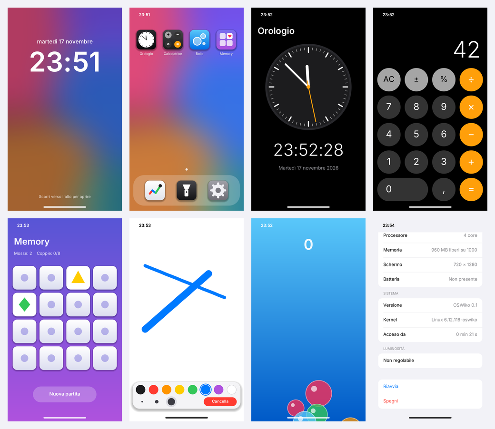
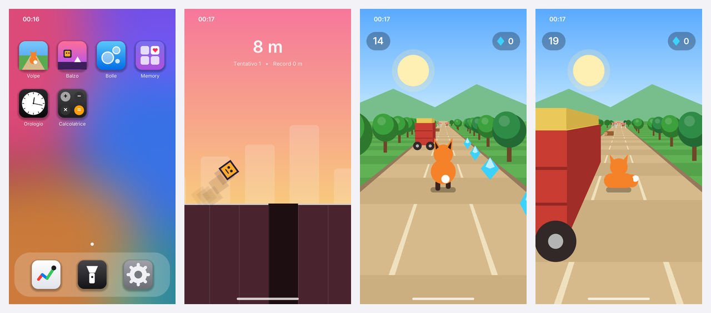
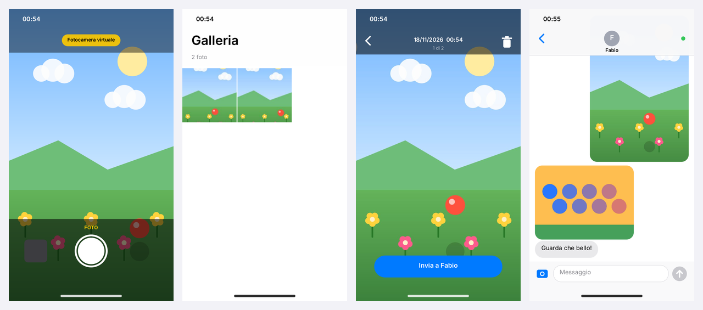
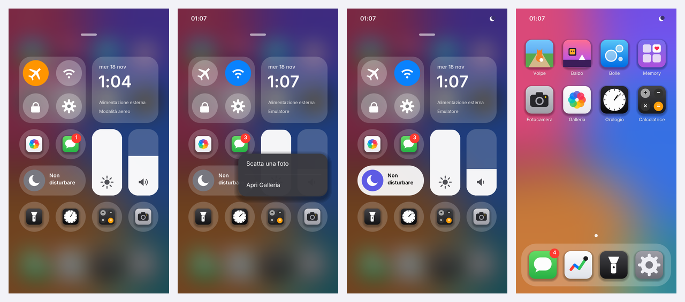
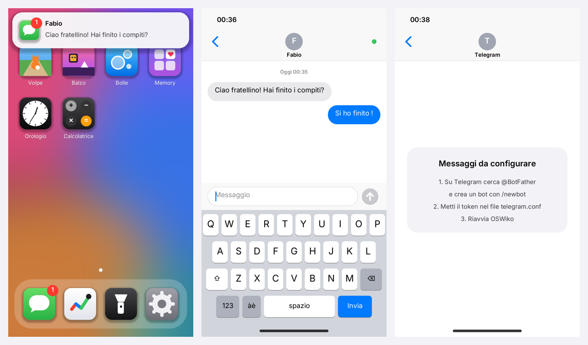

# OSWiko

Un sistema operativo fatto in casa per il **Wiko Ridge 4G** (Snapdragon 410, 2 GB di RAM), con interfaccia touch in stile iOS, giochi e app di sistema. Leggerissimo: l'intero sistema occupa **circa 5 MB** e all'avvio usa una quarantina di MB di RAM.









Per ora gira nell'emulatore QEMU. Il porting sul telefono vero è la fase 2 (vedi [docs/ROADMAP.md](docs/ROADMAP.md)).

## Cosa c'è

| | |
|---|---|
| **Schermata di blocco** | ora, data in italiano, "scorri verso l'alto per aprire" |
| **Home** | griglia di icone, dock in vetro, sfondo sfumato, animazione di apertura delle app |
| **Gesture** | trascina dal bordo inferiore verso l'alto per tornare alla home, dal bordo superiore verso il basso per il centro di controllo |
| **Centro di controllo** | modalità aereo e rete (spengono davvero la connessione), blocco schermo, ora e batteria, cursori di luminosità e volume, Non disturbare (niente banner), scorciatoie; pressione lunga sulla Fotocamera per le opzioni |
| **Volpe in Fuga** | corsa infinita in 3D su 3 corsie nel bosco: swipe per cambiare corsia, saltare i tronchi, scivolare sotto le staccionate; gemme da raccogliere |
| **Balzo** | platform a un tasto: il cubo corre da solo, tocca per saltare spuntoni, blocchi e burroni; percorso fisso da imparare, record e tentativi |
| **Messaggi** | chat stile WhatsApp con te tramite un bot Telegram: testo e **foto** (in entrambe le direzioni), tastiera a schermo italiana, notifiche a banner e badge sull'icona |
| **Fotocamera** | scatta foto (videocamera vera se c'è, altrimenti fotocamera virtuale nell'emulatore) |
| **Galleria** | griglia di miniature, foto a schermo intero con swipe, elimina, "Invia a…" nella chat |
| **Orologio** | quadrante analogico con lancetta dei secondi + ora digitale |
| **Calcolatrice** | stile iOS, funziona anche con la tastiera del PC |
| **Disegno** | tela, 8 colori, 3 pennelli, salva in Galleria |
| **Memory** | trova le 8 coppie di forme |
| **Bolle** | tocca le bolle che salgono (senza game over, pensato per i più piccoli) |
| **Torcia** | schermo a piena luce, tocca per cambiare colore |
| **Impostazioni** | info dispositivo, memoria, batteria, luminosità, riavvia/spegni |

## Com'è fatto

```
kernel Linux 6.12 (minimale, ~4 MB)
└── /init            nostro: monta i filesystem, avvia e sorveglia i processi
    ├── /bin/ui      nostro: interfaccia grafica + app (C, disegno diretto sul framebuffer)
    ├── /bin/msgd    nostro: servizio messaggi (bot Telegram, HTTPS con mbedTLS)
    └── /bin/osh     nostro: shell di debug sulla console seriale
```

Il kernel e i driver sono Linux. Tutto quello che c'è sopra è scritto da zero in C, senza librerie grafiche: forme anti-aliasing, trasparenze, sfocatura, testo vettoriale (font [Inter](https://github.com/rsms/inter) con [stb_truetype](https://github.com/nothings/stb)). Lo schermo si ridisegna solo quando succede qualcosa, così la CPU resta ferma e la batteria dura di più.

```
userland/
  init.c         PID 1
  osh.c          shell di debug
  ui.c / ui.h    sistema: blocco, home, dock, gesture, gestione app
  gfx.c / gfx.h  grafica (forme, alpha, blur, immagini)
  text.c         testo vettoriale con cache dei glifi
  input.c        touchscreen / tasti / tastiera (evdev)
  sys.c          batteria, luminosità, rete, memoria via /sys e /proc
  control.c      centro di controllo
  keyboard.c     tastiera a schermo (italiano) e tastiera fisica
  msgd.c         servizio messaggi: long polling Telegram, abbinamento, invio
  net.c          client HTTPS minimale (mbedTLS)
  image.c        JPEG/PNG (stb_image), ridimensionamento
  photos.c       archivio foto in /data/photos con miniature
  camera_v4l2.c  acquisizione dalla videocamera (V4L2)
  app_*.c        le app
kernel/qemu.config   configurazione del kernel per l'emulatore
scripts/             initramfs e script di avvio
```

## Provarlo su Windows (senza compilare)

1. Installa QEMU: dal cmd lancia `winget install SoftwareFreedomConservancy.QEMU`, oppure scaricalo da <https://www.qemu.org/download/#windows>.
2. Su GitHub apri la scheda **Actions** del repo, scegli l'ultima build verde e scarica l'artifact **oswiko-emulatore** (zip).
3. Estrai lo zip e fai doppio clic su `run-qemu.bat` (schermo 360×640, entra in ogni monitor). Con un monitor grande usa `run-qemu-grande.bat` (576×1024); se i clic non funzionano prova `run-qemu-sdl.bat`.

Chat, foto e record dei giochi vengono salvati in **`data.img`**, il "disco" del telefono, che lo script crea la prima volta. Quando scarichi una versione nuova di OSWiko, **tieni il tuo `data.img`** (e `telegram.conf`): così non perdi niente.

Comandi nell'emulatore: il **mouse** fa da dito (trascina per gli swipe; dal bordo in alto apri il centro di controllo), **ESC** = tasto Home, **F12** = tasto Power, **Invio** sblocca. Nei giochi funzionano anche le **frecce** e la **barra spaziatrice**. Nella finestra del cmd c'è la shell `osh` (digita `help`).

## Messaggi: collegare tuo fratello a te



Tuo fratello scrive dall'app **Messaggi** di OSWiko. Tu ricevi e rispondi dalla normale app **Telegram**, tramite un bot che crei tu (gratis):

1. Su Telegram cerca **@BotFather**, scrivi `/newbot` e scegli un nome (es. "OSWiko di Marco"). BotFather ti dà un **token**, tipo `123456789:AAF...`.
2. Copia `telegram.conf.example` in **`telegram.conf`**, nella stessa cartella di `run-qemu.bat`, e incolla il token. **Non caricare mai questo file su GitHub**: chi ha il token controlla il bot. È già in `.gitignore`.
3. Avvia OSWiko e apri **Messaggi**: compare un codice di 4 cifre.
4. Su Telegram apri il tuo bot e scrivigli quel codice. Fatto: siete collegati.

Il bot accetta messaggi **solo da te**. Chiunque altro gli scriva viene ignorato.

Le foto viaggiano in entrambe le direzioni: quelle che ricevi finiscono anche in Galleria. Per mandarne una, aprila in Galleria e tocca **Invia a…** (o usa il pulsante foto nella chat). Vocali e sticker arrivano ancora come testo segnaposto, e le emoji non si vedono perché il font non le contiene.

Per provarlo senza internet c'è un finto server Telegram: `./tools/mock-telegram.sh` e poi `./tools/run-mock-qemu.sh`.

## Compilarlo (Linux o WSL2 su Windows)

```bash
sudo apt install gcc-aarch64-linux-gnu qemu-system-arm flex bison bc libssl-dev libelf-dev
```
```bash
make
```
```bash
make run
```

La prima volta `make` scarica il sorgente del kernel (~250 MB) e lo compila (pochi minuti). Dopo, cambiare l'interfaccia richiede pochi secondi.

## Aggiungere una app

1. Crea `userland/app_nome.c` con una `struct app` (nome, colori dell'icona, funzioni `draw`/`event`). Guarda `app_torch.c`, è la più semplice.
2. Dichiarala in `ui.h` e aggiungila a `grid_apps` o a `dock_apps` in `ui.c`.
3. Aggiungi il file a `UI_SRC` in `userland/Makefile`.

## Licenze

Codice OSWiko: da definire. Font Inter: SIL OFL 1.1 (`assets/fonts/OFL.txt`). stb_truetype, stb_image, stb_image_write: pubblico dominio / MIT. jsmn: MIT. mbedTLS: Apache-2.0 (scaricato durante la build). Certificati CA (`assets/certs/cacert.pem`, da Mozilla via certifi): MPL-2.0. Kernel Linux: GPL-2.0.
